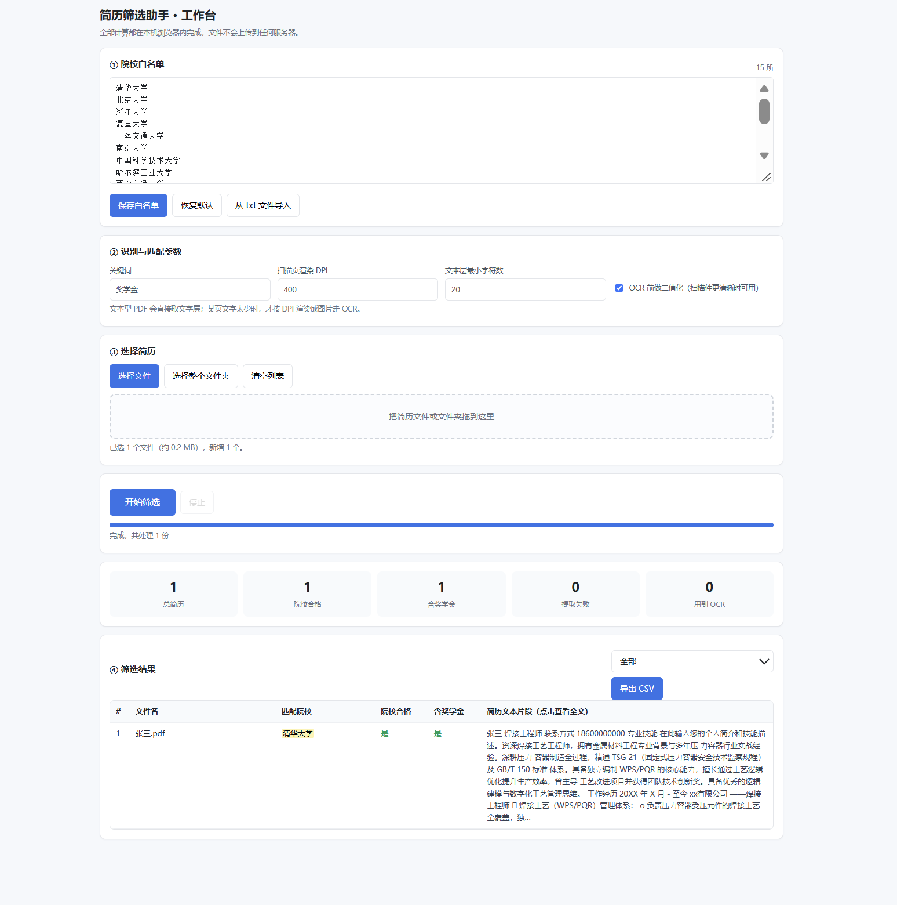

# 简历筛选助手（浏览器插件原型）

> 本地离线批量筛选简历：**PDF/图片 OCR 识别** + **院校白名单匹配** + **奖学金关键词识别** + **一键导出 CSV**。
> 全部计算在浏览器内完成，简历文件不会上传到任何服务器。



## ✨ 功能

- 📄 **多格式支持**：PDF（文本型 + 扫描件）、JPG / PNG / BMP / WEBP
- 🔍 **智能识别策略**：PDF 优先提取文字层，文字过少的页面才渲染成图片走 OCR —— 混合型 PDF 也能正确批处理
- 🏫 **院校白名单匹配**：白名单可在界面内编辑并持久化，命中结果高亮显示
- 🎯 **关键词识别**：默认匹配「奖学金」，关键词可自定义
- ⏱️ **批量处理**：支持整个文件夹递归 + 拖拽导入，实时进度，可随时停止
- 📊 **结果导出**：UTF-8 BOM 的 CSV，Excel 双击不乱码
- 🔒 **完全离线**：无需后端、不上传文件、无需联网（仅首次下载语言包）

## 🧰 技术栈

| 能力 | 方案 |
|---|---|
| 扩展框架 | Chrome/Edge Manifest V3 |
| PDF 解析 | [pdf.js](https://mozilla.github.io/pdf.js/)（`pdfjs-dist`） |
| OCR | [Tesseract.js](https://tesseract.js.org/)（WASM 版 tesseract-ocr） |
| 图像预处理 | Canvas 2D + 手写灰度/Otsu 二值化 |
| 数据持久化 | `chrome.storage.local` |
| 导出 | 手写 CSV + Blob 下载（无第三方库） |

## 🚀 快速开始

```bash
git clone https://github.com/<你的用户名>/resume-screener-extension.git
cd resume-screener-extension
npm install
npm run setup        # 生成 vendor/ 目录并下载 OCR 语言包（约 25MB）
```

加载到浏览器：

1. Chrome 打开 `chrome://extensions`（Edge 打开 `edge://extensions`）
2. 右上角开启 **开发者模式**
3. 点 **加载已解压的扩展程序**，选择本仓库根目录
4. 点插件图标 → **打开工作台** → 选简历文件夹 → **开始筛选**

> 首次识别需要 5~15 秒初始化 OCR 引擎（加载语言包 + 编译 wasm），之后会缓存到 IndexedDB。

## 📁 目录结构

```
.
├── manifest.json            # 扩展清单（MV3）
├── popup.html / popup.js    # 插件弹窗：打开工作台
├── app.html / app.css       # 工作台界面
├── app.js                   # ★ 核心逻辑：OCR + PDF 解析 + 匹配 + 导出
├── tools/
│   ├── copy_vendor.mjs      # 把 pdf.js / tesseract.js 复制到 vendor/
│   └── fetch_tessdata.mjs   # 下载 OCR 语言包
├── vendor/                  # 第三方库（由 setup 生成，不入库）
└── tessdata/                # OCR 语言包（由 setup 生成，不入库）
```

## 🔧 实现要点

1. **文本层优先、OCR 兜底**：逐页判断 `getTextContent()` 的有效字符数，不足阈值才渲染 OCR，避免整份 PDF 白跑一遍识别。
2. **内存控制**：300 DPI 的 A4 渲染约 2500×3500，每页 OCR 完立即 `canvas.width = 0` 释放，否则几张就 OOM。
3. **MV3 CSP 适配**：manifest 中需声明 `'wasm-unsafe-eval'`，且 tesseract worker 需设 `workerBlobURL: false`，否则 wasm 实例化和 blob worker 都会被 CSP 拦掉。
4. **长任务架构**：重活放在独立标签页（`app.html`）而非 popup —— popup 一关闭 JS 上下文即销毁。
5. **中文 PDF 支持**：pdf.js 需配置 `cMapUrl` 指向本地 `cmaps/`，否则 CID 字体文档提取为空白。
6. **精确的失败反馈**：导入文件时统计被跳过的格式，只在实际发生时提示，
   避免无关的警告信息干扰用户（例如导入纯 PDF 时不应出现 TIFF 提示）。
7. **同形异码（homoglyph）处理**：部分中文 PDF 的嵌入字体会把汉字映射到「康熙部首」区
   （例如把 大 U+5927 映射成 ⼤ U+2F24），二者字形完全相同、码点不同，
   直接做字符串比较必然失败。解决方案是匹配前统一执行 Unicode NFKC 归一化
   （统一异码字符）并剥离空白与零宽字符。

## ⚠️ 已知限制

- 浏览器不支持解码 TIFF，需先转成 PNG/JPG
- OCR 为单 worker 串行处理，几百份简历较慢
- 不支持加密 PDF

## 🗺️ Roadmap

- [ ] 多 Worker 并行，提速 2~4 倍
- [ ] 院校简称映射（"浙大" → "浙江大学"）
- [ ] 结果持久化，页面误关可恢复
- [ ] 支持在招聘网站页面直接抓取文本匹配

## 📄 License

[MIT](LICENSE)